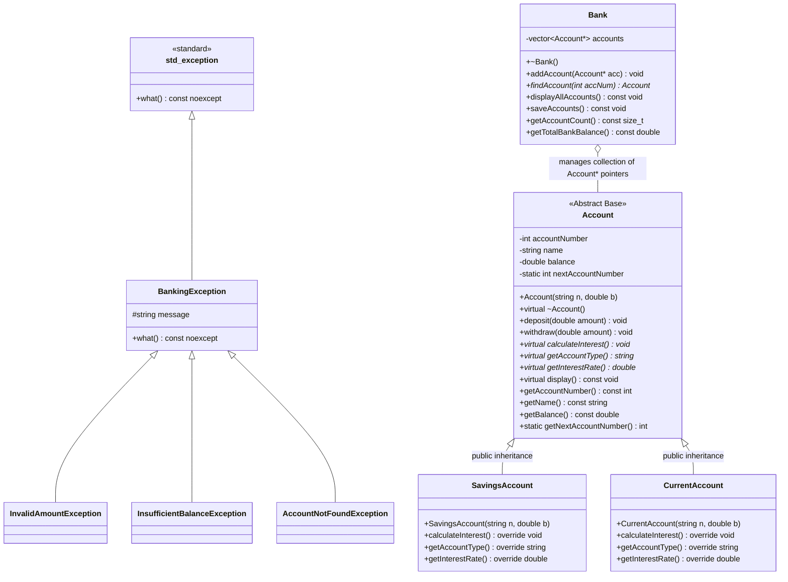

# Bank Account Management System (C++ OOP Course Project)

> **Course:** Object-Oriented Programming (OOP) in C++  
> **Author:** [Purva Deshmukh](https://github.com/purvaa211)  
> **Repository:** [https://github.com/purvaa211/Bank-Account-Management-](https://github.com/purvaa211/Bank-Account-Management-)  
> **Language / Standard:** C++ (C++11 / C++14 / C++17 compatible)  

---

## 1. Project Purpose & Overview

The **Bank Account Management System** is a console-based application designed to demonstrate the core tenets of **Object-Oriented Programming (OOP)** in C++.

The project demonstrates clean, syllabus-compliant OOP architecture combined with a structured console interface featuring ANSI color styling, formatted receipts, tabular passbook views, and robust input validation.

### Key Highlights
- **Core C++ OOP Principles**: Implements Abstraction, Encapsulation, Inheritance, and Runtime Polymorphism.
- **Robust Exception Handling**: Custom exception hierarchy inheriting from `std::exception`.
- **Memory Safety**: Dynamic memory allocation (`new` / `delete`) managed via STL `std::vector<Account*>`.
- **Input Validation**: Safe line-based stream handling prevents buffer overflows and infinite loops on invalid input.
- **File Persistence**: Formatted export of all bank records and summaries to `accounts.txt`.
- **Build Automation**: Single-command compilation using `build.bat` (Windows), `make` (Linux/macOS), or standard `g++`.

---

## 2. Project Architecture & File Structure

The project strictly follows modular design with complete header (`.h`) and implementation (`.cpp`) separation:

```
Bank-Account-Management-/
|
|-- Account.h               # Abstract Base Class header (encapsulation, pure virtual methods)
|-- Account.cpp             # Base class implementations, static counter, transactions
|-- SavingsAccount.h        # Derived Savings Account header (4% interest)
|-- SavingsAccount.cpp      # Savings Account interest calculation implementation
|-- CurrentAccount.h        # Derived Current Account header (0% checking)
|-- CurrentAccount.cpp      # Current Account commercial logic implementation
|-- Bank.h                  # Bank container class header (vector<Account*>, lookup)
|-- Bank.cpp                # Bank operations, memory deallocation, file saving
|-- Exceptions.h            # Custom domain exception hierarchy (std::exception)
|-- UIHelper.h              # Terminal styling, ANSI colors, safe input parsing header
|-- UIHelper.cpp            # UI formatting, transaction receipts, passbook display
|-- main.cpp                # Menu controller & application entry point
|
|-- docs/                   # Web Platform (GitHub Pages)
|   |-- index.html          # Interactive Web UI & OOP Inspector
|   |-- style.css           # Modern Fintech stylesheet
|   `-- app.js              # JavaScript OOP engine & C++ concept mappings
|
|-- build.bat               # 1-Click Windows build & launch script
|-- Makefile                # Cross-platform Makefile
|-- .gitignore              # Git ignore rules for build artifacts
`-- README.md               # Project documentation
```

---

## 3. Class Hierarchy & Architecture Diagram



---

## 4. Mapping of OOP Concepts to Code

| OOP Concept | File / Implementation | Role & Implementation Details |
|---|---|---|
| **Class & Object** | `Account`, `Bank`, `SavingsAccount`, `CurrentAccount` | Encapsulates state and behaviors into logical real-world entities. |
| **Encapsulation** | `Account.h` (`private` members, `public` getters/methods) | Protects internal state (`balance`, `accountNumber`) from direct external mutation. |
| **Constructor** | `Account::Account(const string& n, double b)` | Initializes object attributes at creation and assigns auto-incremented account number. |
| **`this` Pointer** | `Account.cpp` (`this->name = n; this->balance = b;`) | Resolves naming ambiguity between member variables and constructor parameters. |
| **Destructor & Cleanup** | `Bank::~Bank()` | Iterates over the `vector<Account*>` and deallocates every dynamically allocated object (`delete account`). |
| **Virtual Destructor** | `Account.h` (`virtual ~Account();`) | Ensures the complete derived class destructor chain runs when deleting via an `Account*` pointer. |
| **Static Data Member** | `int Account::nextAccountNumber = 1001;` | A single shared counter across all account objects to guarantee unique, sequential account numbers. |
| **Static Member Function** | `Account::getNextAccountNumber()` | Class-level utility function accessing static data without requiring an object instance. |
| **Inheritance** | `SavingsAccount : public Account`, `CurrentAccount : public Account` | Reuses common banking logic (`deposit`, `withdraw`, `display`) while customizing account specifics. |
| **Abstract Base Class** | `class Account` | Contains pure virtual functions (`= 0`), serving as an interface contract that cannot be instantiated directly. |
| **Pure Virtual Function** | `virtual void calculateInterest() = 0;` | Enforces mandatory override in derived classes tailored to their interest rules (4% vs 0%). |
| **Runtime Polymorphism** | `main.cpp` (`account->calculateInterest();`) | Dynamic dispatch: invoking virtual methods through `Account*` resolves to the actual derived object method at runtime. |
| **Custom Exception Handling** | `Exceptions.h` (`InvalidAmountException`, etc.) | Domain-specific error reporting derived from `std::exception` handled cleanly with `try-throw-catch`. |
| **STL Container** | `std::vector<Account*> accounts;` in `Bank` | Dynamic array container to hold, traverse, and manage polymorphic base-class pointers. |
| **File Handling** | `Bank::saveAccounts()` using `std::ofstream` | Serializes in-memory account records and aggregate summaries into persistent disk storage (`accounts.txt`). |

---

## 5. How to Build and Run

### Windows (build.bat)
Open Command Prompt or PowerShell in the project directory and run:
```cmd
build.bat
```
This compiles all files and launches the program.

### Manual Compilation (g++)
```bash
g++ -std=c++11 -Wall -Wextra Account.cpp Bank.cpp CurrentAccount.cpp SavingsAccount.cpp UIHelper.cpp main.cpp -o bank_management.exe
.\bank_management.exe
```

### Makefile (Linux / macOS / MinGW)
```bash
make
make run
```
To clean build artifacts:
```bash
make clean
```

---

## 6. Interactive Web Platform & GitHub Pages

An interactive web version of the system is provided in the `docs/` folder to demonstrate the banking operations visually alongside live C++ OOP concept inspections:

- **Live Web App:** [https://purvaa211.github.io/Bank-Account-Management-/](https://purvaa211.github.io/Bank-Account-Management-/)
- **Local Browser Access:** Double-click `docs/index.html` or open it in any modern browser (pure client-side, no dependencies or web servers needed).

### Web Platform Features
- **Interactive Banking Operations:** Open Savings/Current accounts, perform deposits, withdrawals, and calculate interest in real-time.
- **Synchronized C++ OOP Inspector:** Every action highlights the corresponding C++ source code snippet and explains the underlying OOP principle (Encapsulation, Polymorphism, Inheritance, Exception Handling).
- **Simulated C++ Console Terminal:** Displays the exact ANSI-styled console output generated by the C++ executable.
- **accounts.txt File Viewer & Downloader:** Previews and exports the persistent file record created by C++ `std::ofstream`.
- **C++ Source Code Explorer:** Read the complete C++ header and implementation files right in the browser.

---

## 7. Console Interface Overview

### Main Dashboard
A framed menu providing categorized operations with live active-account indicators:
```
+====================================================================+
|                 BANK ACCOUNT MANAGEMENT SYSTEM                     |
|              C++ Object-Oriented Programming Project               |
+====================================================================+
 Status: Operational   |   Active Accounts: 2
+--------------------------------------------------------------------+
| ACCOUNT CREATION & MANAGEMENT                                      |
|  [1] Create Savings Account    (Earns 4.0% annual interest)        |
|  [2] Create Current Account    (Transactional / Checking account)  |
+--------------------------------------------------------------------+
| TRANSACTIONS & OPERATIONS                                          |
|  [3] Deposit Funds             (Add funds to balance)              |
|  [4] Withdraw Funds            (Deduct funds from balance)         |
|  [5] Check Balance             (Fast balance inquiry)              |
+--------------------------------------------------------------------+
| REPORTS & FILE PERSISTENCE                                         |
|  [6] Display Account Details   (Full passbook card view)           |
|  [7] Display All Accounts      (Tabular list of all accounts)      |
|  [8] Calculate Interest        (Polymorphic interest simulation)   |
|  [9] Save Accounts to File     (Export database to accounts.txt)   |
+--------------------------------------------------------------------+
|  [10] Exit Program                                                 |
+====================================================================+
```

### Transaction Receipt (Deposit / Withdrawal)
Every deposit and withdrawal generates an audit receipt:
```
+-------------------------------------------------------------+
|                    TRANSACTION RECEIPT                      |
+------------------------------+------------------------------+
| Account Number               | 1001                         |
| Account Holder               | Purva Deshmukh               |
| Account Type                 | Savings Account              |
| Transaction Type             | DEPOSIT                      |
| Previous Balance             | $10,000.00                   |
| Transaction Amount           | $5,000.00                    |
| Updated Balance              | $15,000.00                   |
+-------------------------------------------------------------+
[SUCCESS] Funds deposited successfully!
```

### Account Passbook Card
```
+-------------------------------------------------------------+
|                     ACCOUNT PASSBOOK CARD                   |
+------------------------------+------------------------------+
| Account Number               | 1001                         |
| Account Holder               | Purva Deshmukh               |
| Account Type                 | Savings Account              |
| Current Balance              | $15,000.00                   |
+-------------------------------------------------------------+
```

### Tabular Account Directory
Displays all accounts in an aligned grid with summary totals:
```
+-------+--------------------------------+-----------------+-----------------+
| ACC # | ACCOUNT HOLDER                 | ACCOUNT TYPE    | CURRENT BALANCE |
+-------+--------------------------------+-----------------+-----------------+
| 1001  | Purva Deshmukh                 | Savings Account |      $15,000.00 |
| 1002  | Tech Innovations Ltd           | Current Account |      $25,000.00 |
+-------+--------------------------------+-----------------+-----------------+
 Total Accounts: 2   |   Total Deposits Under Management: $40,000.00
```

### Persistent Disk Export (accounts.txt)
Option 9 exports complete records into human-readable format:
```
======================================================================
                 BANK ACCOUNT MANAGEMENT SYSTEM RECORD                
======================================================================

Account Number : 1001
Account Holder : Purva Deshmukh
Account Type   : Savings Account
Balance        : $15000.00
Interest Rate  : 4.0%
----------------------------------------------------------------------
Account Number : 1002
Account Holder : Tech Innovations Ltd
Account Type   : Current Account
Balance        : $25000.00
Interest Rate  : 0.0%
----------------------------------------------------------------------

SUMMARY:
Total Accounts : 2
Total Reserves : $40000.00
======================================================================
```

---

## Author
- **Purva Deshmukh** — [GitHub Profile](https://github.com/purvaa211)
- Repository: [https://github.com/purvaa211/Bank-Account-Management-](https://github.com/purvaa211/Bank-Account-Management-)
